<div align="center">

<br>
<div align="center">
  <a href="https://git.io/typing-svg">
    
  </a>
</div>
<br><br>
<h2 align="left">⚡ Minhas Contribuições &amp; Commits</h2>
<br><br>
<h2 align="left">🌌 Sobre mim</h2>
<table><tr>
<td valign="top"></td>
<td valign="top"></td>
</tr></table>
<br>
<div align="center">

</div>
<br><br>
</div>

<h3 align="left">📋 Informações pessoais</h3>

```typescript
const thales = {
  apelido:        "Xikreti 😎",
  nome:           "Thales Cardoso",
  cidade:         "Divinópolis MG",
  empresa:        "Owner Tayrus",
  status:         "Codando agora",
  café:           "Necessário",
  localização:    "Brasil 🇧🇷",
  função:         "Desenvolvedor Full Stack & Web3",
  missão:         "Transformar ideias em experiências digitais",
  aprendendo:     ["Blockchain", "Solidity", "Next.js", "UI/UX Design"],
  hobbies:        ["Ler livros 📚", "Jogar video games 🎮", "Produzir músicas 🎵"],
  superPoder:     "Tornar o complexo em algo belo e simples",
  funFact:        "Personalizo até o Windows para parecer macOS 🍎"
};
```

<br/>


<h2 align="left">🛸 Stack de Tecnologias</h2>

<div align="center">

<h3 align="center">🎨 Front-end</h3>
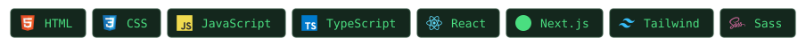

<h3 align="center">⚙️ Back-end & DB</h3>
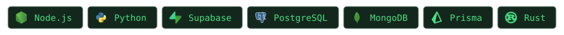

<h3 align="center">🔗 Web3 & Blockchain</h3>
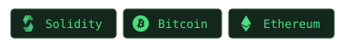

<h3 align="center">🛠️ Ferramentas & Ambiente</h3>
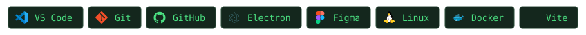

</div>

<br/>

---

<h2 align="left">🏆 Troféus</h2>

<div align="center">
  
</div>

<br/>

---

<h2 align="left">🌐 Onde me encontrar</h2>

<div align="center">

[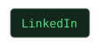](https://www.linkedin.com/in/xikreti/)
[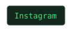](https://www.instagram.com/xikretii/)
[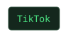](https://www.tiktok.com/@xikreti)
[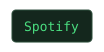](https://open.spotify.com/intl-pt/artist/3rkJ3Wnc47e1ZHi6Q3UhMx?si=3xZBJpb3RbySeWtJZZCkNw)

</div>

<br/>

---

<!-- Citação -->
<div align="center">

> *"É que eles me chamam de louco, mas não entendem minha loucura,*
> *eles querem as coisas fáceis e não praticam a Lei da Semeadura."*
>
> — **Xikreti** 🎵

</div>

<!-- Rodapé animado -->
<div align="center">
  
</div>
